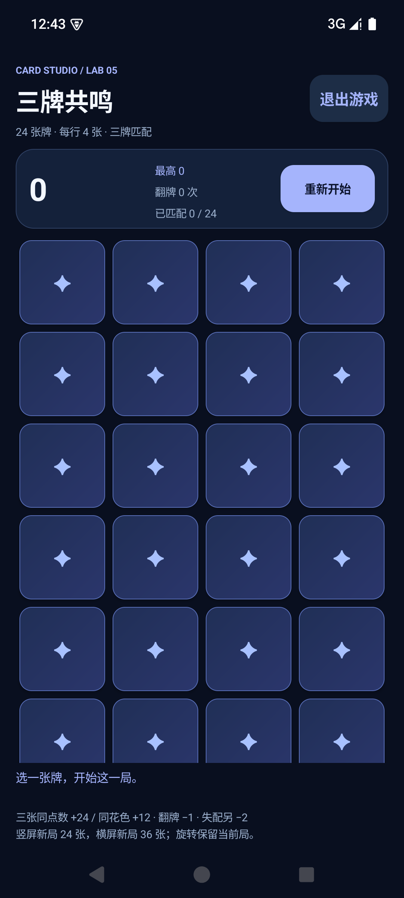
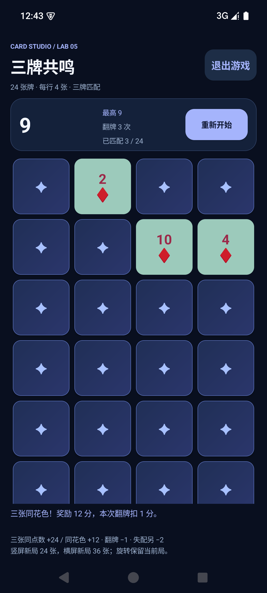
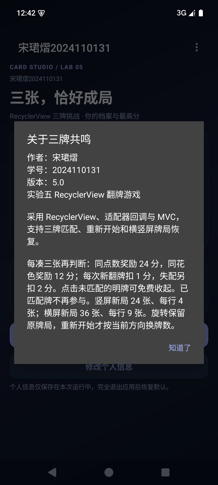

# 实验五 RecyclerView 三牌翻牌游戏

作者：宋珺熠，学号：2024110131。应用标题：宋珺熠2024110131。

本实验从实验四提交 `3617f28` 独立克隆，在 `Dev` 分支开发；实验四本地工程、APK 和报告均未修改。旧版源码可从 `lab4-complete` 标签查看。

## 在 Android Studio 运行

本机打开固定英文目录 `C:\Users\48604\Documents\ChatGPT\android-labs\assignment5-project`。工作区中的 `assignment5-recyclerview` 是指向该目录的链接，不是实验四目录。

JBR 17 以上、SDK 35、Gradle 8.13、AGP 8.13.2、Kotlin 2.1.20。运行 `app`。独立包名 `com.songjunyi.cardgame.lab5`，可与实验四同时安装。未知性别、电话、邮箱和爱好不擅自填写。

## 功能与规则

- 仍包含主页、修改资料、翻牌游戏三个 Activity，主页右上角溢出菜单打开关于对话框。
- RecyclerView + GridLayoutManager + CardAdapter。适配器实现 ViewHolder 创建、绑定、条目数量、稳定ID和点击回调；通过 bindingAdapterPosition 防止复用后位置失效，用 DiffUtil 更新变化。
- 三张同点数奖励24分，三张同花色奖励12分，点数优先。每次新翻牌扣1分，失配另扣2分。连续从零翻三张后的净分分别为21、9或-5。
- 前两张明牌等待第三张；未匹配明牌可免费收起。失配时前两张收起，保留新翻的第三张；匹配成功三张保持明牌并禁用。
- 竖屏新局24张，每行4张；横屏新局36张，每行9张。列表可以滚动。旋转保留当前局牌数和全部状态，点击重新开始才按当前方向调整牌数。
- CardMatchingGame.reset 在原模型实例中洗牌、清零；最高分不降低。资料和最高分仅存于应用进程内存，不写文件。
- 所有界面文案、菜单、对话框、牌面符号和格式文字来自字符串资源。

## MVC

Model 位于 `model/`，独立处理三牌匹配、计分、reset、终局和快照。View 是 RecyclerView、CardAdapter 和字符串资源，不计算分数。GameActivity 是 Controller：接收回调、调用模型、记录最高分并刷新界面。BoardLayout 负责可单测的横竖屏新局牌数/列数策略。

## 实测结果

23项 JUnit 模型测试、10项 API 35 模拟器 Instrumentation UI 测试全部通过。Android Lint 0错误、3个警告（SDK版本更新建议及备份规则）；其他设备与Android版本未验证。UI测试真实点击菜单及卡牌，随机牌局只读当前模型来选择可验证组合。截图中的“示例玩家”、10086、player@example.com、性别和爱好是测试数据。

```powershell
.\gradlew.bat :app:assembleDebug :app:testDebugUnitTest :app:connectedDebugAndroidTest :app:lintDebug '-Pandroid.injected.androidTest.leaveApksInstalledAfterRun=true'
```

首次需要联网下载依赖，缓存齐全后可加 `--offline`。设备测试需要已启动模拟器。XML结果和真实运行截图位于 `report-assets/lab5/`；实验四的历史证据仍单独保留在原有路径。





## GitHub 分支与 PR

沿用仓库：https://github.com/StephenYI43/card-game-2024110131 。保留 `main` 和 `Dev`。main 禁止直接 push，要求 PR 和 `Local Android verification` 提交检查通过，并对管理员执行保护。Dev 不在合并后删除。

GitHub 不允许作者批准自己的 PR，因此独立个人实验使用“强制 PR、0个外部批准、提交检查必过”，并通过 PR 评论记录代码自审，不冒充第二名审核人。没有使用管理员绕过合并。本次登录没有 workflow 写权限，因此不运行 GitHub Actions；构建、23项单元测试、10项设备UI测试和 Lint 均在本机实际完成，再将带有原始XML证据链接的成功状态登记到对应提交，不把本机测试冒充云端CI。

实验报告由工作区附件模板通过 WPS 接口填写，另存为实验五文件，不使用桌面点击自动化。报告及生成脚本使用独立 lab5 文件名；实验四文件未覆盖。

官方参考：[RecyclerView](https://developer.android.com/develop/ui/views/layout/recyclerview)、[版本1.4.0](https://developer.android.com/jetpack/androidx/releases/recyclerview)、[GitHub分支保护](https://docs.github.com/en/repositories/configuring-branches-and-merges-in-your-repository/managing-protected-branches/about-protected-branches)。
