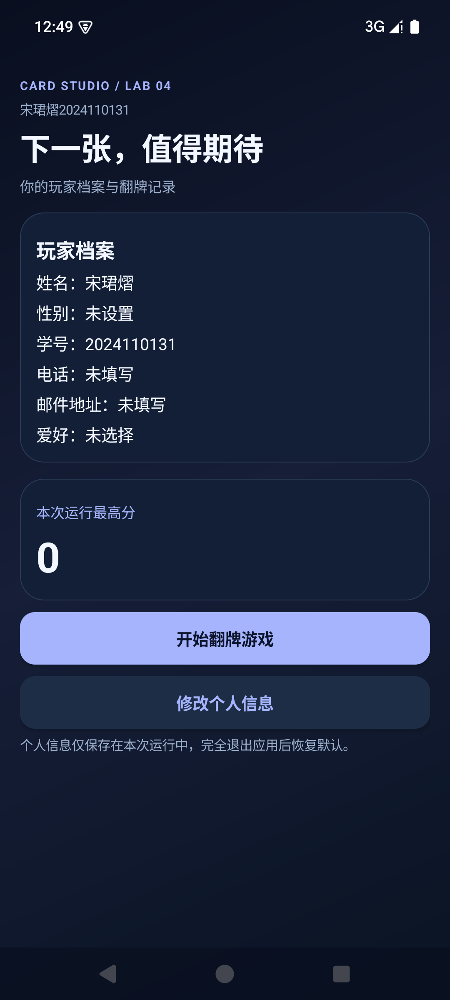
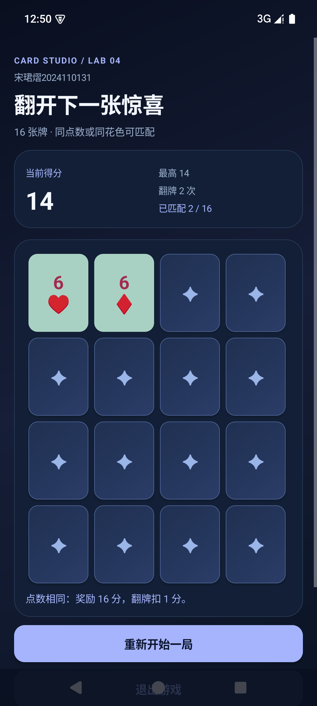
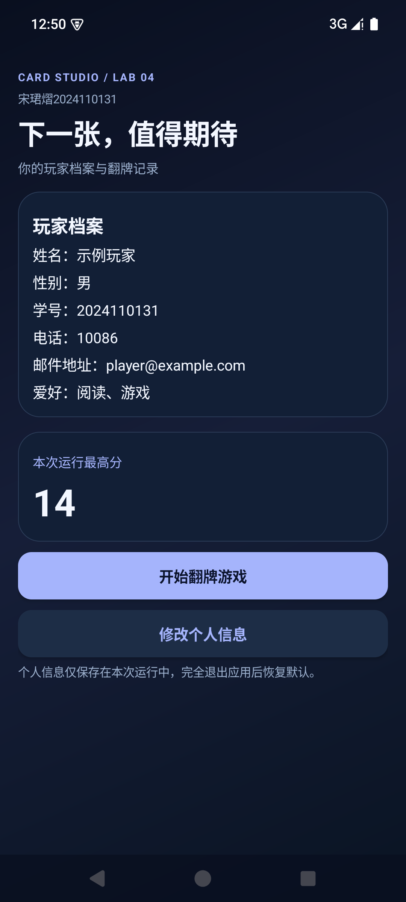

# 实验四 翻牌游戏应用

作者：宋珺熠（2024110131），应用标题：**宋珺熠2024110131**。

Android Studio 独立工程，包含 3 个 Activity：玩家主页、个人信息修改、翻牌游戏。按课程 model.zip 实现 MVC，支持 16 张牌交互、得分同步、重新开始、内存最高分和横竖屏牌局恢复。

## 运行

本机推荐在 Android Studio 打开：

```text
C:\Users\48604\Documents\ChatGPT\android-labs\assignment4-project
```

原工作区的 assignment4-card-game 是指向同一工程的目录链接，没有第二份源码。固定英文目录用于解决 Windows 中文路径下 Gradle JUnit 的 ClassNotFoundException，不依赖临时盘符。其他电脑克隆到英文路径即可。

使用 Android Studio 内置 JBR（本机为 21），安装 SDK 35，启动 API 23 以上的模拟器/真机，运行 app。本次实测设备是 API 35 模拟器。

## 功能与 MVC

| 部分 | 文件 | 职责 |
| --- | --- | --- |
| 主页控制器 | MainActivity.kt | 展示资料、导航、接收修改结果 |
| 修改页面 | ProfileActivity.kt | 姓名、学号、电话、邮箱、性别、爱好，保存/取消与校验 |
| 模型 | model/Card.kt、Deck.kt、CardMatchingGame.kt | 52张牌不放回抽取、选择、匹配、计分、快照 |
| 内存资料 | model/PlayerSession.kt、GameApplication.kt | 资料与本次运行最高分，不写入文件 |
| View | GameBoardView.kt、ScreenActivity.kt、字符串/主题资源 | 卡牌网格、牌面、明暗状态与可点击状态 |
| 游戏控制器 | GameActivity.kt | 处理按钮事件、调用模型、同步界面与重开牌局 |

Manifest 恰好声明 3 个 Activity，共享的抽象 ScreenActivity 不单独注册。默认姓名/学号是真实作业身份，未知性别、电话、邮箱与爱好显示未设置或未填写。测试截图中的“示例玩家”、10086、player@example.com、性别与爱好是测试数据。

## 课程计分规则

- 新翻一张牌扣 1 分，收起已翻开但未匹配的牌不再扣分。
- 相同点数匹配奖励 4 × 4 = 16 分；两次新翻牌后净得 14 分。
- 仅花色相同奖励 1 × 4 = 4 分；两次新翻牌后净得 2 分。
- 点数/花色均不同另扣 2 分；两次新翻牌后合计扣 4 分。
- 匹配成功的两张牌保持明牌并禁用。不匹配时上一张牌收起，当前牌保持翻开。
- 当前分数可以为负数；本次运行最高分从0开始且不会降低。重新开始只清空本局数据。
- 全部匹配或剩余牌已不存在可匹配组合时提示结束，可重新开始。

## 测试

```powershell
.\gradlew.bat :app:assembleDebug :app:testDebugUnitTest :app:connectedDebugAndroidTest :app:lintDebug
```

首次需联网下载依赖，缓存完整后可加 --offline。连接设备的测试需要运行中的 Android 模拟器或调试设备。

14 项 JUnit 4 单元测试位于 app/src/test：规则优先级、同花色、失配、抽牌唯一性、非法输入、翻牌/收起、奖励与费用、状态快照、终局、新局与最高分。

7 项原生 Android Instrumentation UI 测试位于 app/src/androidTest，并由 connectedDebugAndroidTest 执行。覆盖默认资料、保存/取消、非法输入、翻牌/收起、匹配/重开/最高分、失配与旋转。测试对随机牌局只读取当前模型以选择需要验证的组合，实际交互通过界面按钮完成。

两类测试均已在本机通过；Lint 为 0 错误、6 警告（工具版本、备份规则、未使用资源和代码创建的自定义View构造方法）。HTML报告位于 app/build/reports/tests 与 app/build/reports/androidTests；真实XML与截图归档在 report-assets。

要在 Gradle 测试后保留设备上的测试截图，可使用以下参数（PowerShell 必须整体加引号）：

```powershell
.\gradlew.bat :app:connectedDebugAndroidTest '-Pandroid.injected.androidTest.leaveApksInstalledAfterRun=true'
adb pull /sdcard/Android/data/com.songjunyi.cardgame/files/ui-test-evidence/. report-assets
```

## 报告与截图

docs 中保存填写完成的实验报告，包含真实运行截图、带行号源码摘录、两类测试记录与分析。报告通过 WPS 的 kwps.Application 接口生成，并用 WPS 原生PDF导出检查分页，不使用桌面点击自动化。





## 说明

界面文案、牌面符号、提示、格式字符串均使用 res/values/strings.xml。Bundle键名、技术标识与测试诊断字符串不属于界面文案。主题采用原生 Material NoActionBar，按钮清除背景 tint 后显示自定义颜色。

个人信息与最高分仅存于应用进程内存。进程重新启动后恢复默认；屏幕旋转会保存并恢复当前牌局。已验证范围为 API 35 模拟器，其他 Android 版本和品牌真机尚未验证。

参考课程提供的 model.zip、翻牌游戏.pdf、实验四报告模板。项目地址：https://github.com/StephenYI43/card-game-2024110131
